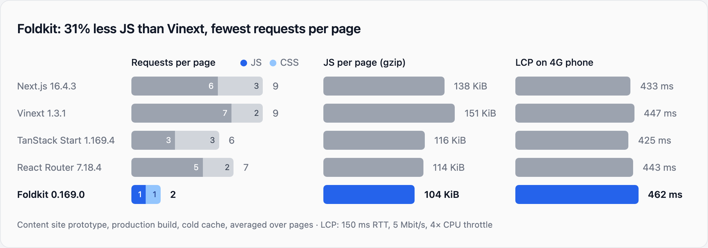

# web-framework-comparison

An open benchmark that builds the same content site ("Field Notes": home, blog
index, about, 24 articles, 16 interactive widgets) in several web frameworks.
A Playwright harness measures each production build: JS and CSS requests per
page, JS weight, and LCP on a throttled 4G phone.



## Latest results

Run on 2026-10-26 (darwin, Node v24.21.0, Chromium 156.0.8078.4).
Averages over 6 pages. Weight is the mean of 3 cold loads; LCP is the
median of 5 cold loads per page.

| Framework | JS requests | CSS requests | JS (gzip) | LCP, 4G phone | Other data requests |
| --- | --- | --- | --- | --- | --- |
| Next.js 16.4.3 | 6.0 | 3.0 | 138 KiB | 433 ms | 8.9 |
| Vinext 1.3.1 | 7.0 | 2.0 | 151 KiB | 447 ms | 4.5 |
| TanStack Start 1.169.4 | 3.0 | 3.0 | 116 KiB | 425 ms | 0.0 |
| React Router 7.18.4 | 5.0 | 2.0 | 114 KiB | 443 ms | 1.0 |
| Foldkit 0.169.0 | 1.0 | 1.0 | 104 KiB | 462 ms | 0.0 |

"Other data requests" are RSC prefetches, server-function calls and route
manifests. They aren't in the chart. Raw data, including a per-page breakdown
and every request for one sample load, is in
[`bench/results/latest.json`](bench/results/latest.json).

These numbers come from one machine and one small fixture. Run the benchmark
yourself before drawing conclusions, and please open an issue if a framework's
implementation isn't idiomatic.

## Frameworks

| Framework      | App                   | Rendering                       | Server used for the bench |
| -------------- | --------------------- | ------------------------------- | ------------------------- |
| Next.js        | `apps/next`           | App Router, RSC, SSG            | `next start`              |
| Vinext         | `apps/next` (same!)   | the same `app/` dir, built by Vite | `vinext start`         |
| TanStack Start | `apps/tanstack-start` | SSR, data via `createServerFn`  | `vite preview`            |
| React Router 7 | `apps/react-router`   | framework mode, SSR, server loaders | `react-router-serve`  |
| Foldkit        | `apps/foldkit`        | SSG + hydration, data via Flags | `vite preview` (static)   |

## The fixture

- **`packages/content`**: deterministic data (posts, comments, team, FAQ) and a
  small global stylesheet with only tokens and a reset.
- **`packages/react-ui`**: every component and page body, each component with
  its own CSS module. All four React apps render these same components; the
  only per-framework code is routing, data loading and a `Link` adapter.
  - 16 client components: theme toggle, mobile menu, search dialog (⌘K),
    newsletter form, back-to-top, cookie banner, like button, share menu, code
    copy button, table of contents with scroll-spy, reading progress bar, topic
    tabs, paginator, FAQ accordion, contact form, and comments. Comments are a
    `React.lazy` chunk, loaded only when scrolled into view.
  - About 15 static components (header, footer, hero, post card, meta, tags,
    breadcrumbs, author bio, callout, team grid, …). These are server
    components in Next/vinext.
  - 28 CSS modules, so frameworks differ in how they split and bundle CSS.
- **Foldkit** reimplements the same pages and widgets in Elm style, and imports
  the same CSS modules from `@bench/react-ui`, so the markup and styles match.

## Usage

Requires Node 24+ (the bench scripts are TypeScript run directly by Node) and pnpm 10.

```sh
corepack enable          # or: npx pnpm@10 ...
pnpm install
pnpm build               # builds every app (Next.js and vinext both build apps/next)
pnpm bench               # starts each prod server, measures, writes bench/results/latest.json
pnpm chart               # renders bench/results/chart.{html,png}
```

Options:

```sh
pnpm bench --only next,foldkit --runs 5 --phone-runs 9 --settle 1000
pnpm chart --highlight tanstack-start --title "My title" --subtitle "..."
```

## What is measured

For each framework, each page in `benchmarkPaths` is loaded `--runs` times. Every
load uses a fresh browser context, so the cache is cold. The harness waits for
`networkidle` plus a settle period (default 1s), which lets idle-time work such
as viewport link prefetching happen.

- **Requests per page**: the number of JS and CSS responses. The harness also
  records `data` requests (Next/vinext RSC prefetches, server-function calls)
  in `latest.json` and prints them in the console table, but they are not
  part of the chart.
- **JS per page (gzip)**: every JS response body is gzipped locally at level 6.
  This puts all servers on equal terms, whether or not they compress their
  responses themselves.
- **LCP on a 4G phone**: each page is loaded `--phone-runs` times (default 5)
  in a 390×844 mobile viewport. The network is throttled to 150 ms RTT and
  5 Mbit/s and the CPU to 4× slower, the same profile as the vinext 1.3 post.
  The cache is cold. The chart uses the median LCP per page, averaged over
  pages. FCP and the load event are recorded too.
- **Sanity check**: after load, the harness clicks the theme toggle and checks
  that it worked. A page that failed to hydrate is reported with a `!` warning.

The chart shows the average over all benchmark pages. `latest.json` has a
per-page breakdown, plus a sample list of every request for the first run.

## Adding a framework

1. Create `apps/<name>` with a `build:all` script. A React framework should
   render the page components from `@bench/react-ui` and import
   `@bench/content/styles.css`. A non-React framework should port the pages and
   import the same CSS modules.
2. Add an entry to `bench/src/targets.ts`, with the production start command
   and a free port.

## Fairness notes and caveats

- **TanStack Start** loaders are isomorphic. Calling `@bench/content` directly
  from a loader would ship every post to the client, so the data goes through
  `createServerFn`, which is the idiomatic pattern.
- **Foldkit** pages are prerendered, and each page's data goes to the client
  in Flags. Foldkit has no RSC-style data fetching on client navigation, so
  links do a full document load (MPA style). This doesn't change initial-load
  numbers, but it does mean Foldkit makes no prefetch requests at all.
- **React Router** uses its defaults: `<Link>` doesn't prefetch, and lazy route
  discovery makes one `/__manifest` request per page, which counts as `data`.
  Framework-mode loaders run only on the server, so the content stays out of
  the client bundle.
- **Next/vinext** prefetch links in the viewport. Those RSC requests count as
  `data`, not JS. Any route chunks that prefetching pulls in do count as JS.
- **Foldkit** has no lazy loading in this port: the comments code is in the
  main bundle, and only their rendering waits for the section to scroll into
  view.
- In the React apps outside Next/vinext, the shared page components import
  `@bench/content` (site copy, FAQ, the post generator) into the client bundle.
  Foldkit does the same. That adds a few KiB of JS.
- LCP runs on localhost with emulated throttling, so it captures round trips,
  bandwidth and CPU, but not real TLS, DNS or CDN behavior.

## License

[MIT](LICENSE)
